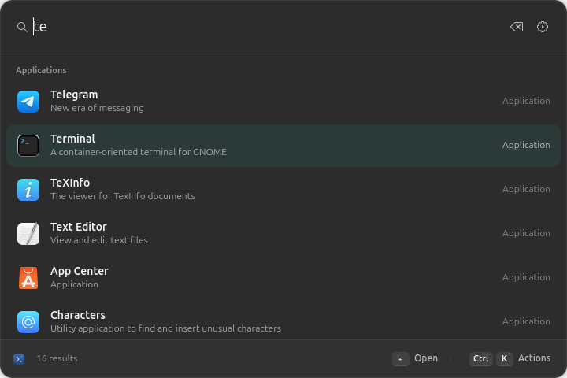

<h1 align="center">Lumen</h1>

<p align="center">
  <strong>Everything on your desktop, one keystroke away.<br>A fast, native command launcher for GNOME.</strong>
</p>

<p align="center">
  <a href="https://farvisun.github.io/gnome-launcher/">Website</a> ·
  <a href="https://github.com/farvisun/gnome-launcher/releases/latest">Download</a> ·
  <a href="#install">Install</a> ·
  <a href="#faq">FAQ</a>
</p>

<p align="center">
  <a href="https://github.com/farvisun/gnome-launcher/releases/latest"></a>
  
  
</p>

<p align="center">
  
</p>

Press **Super + Space**, type a few letters and press **Enter**. Lumen opens apps and files, does quick maths, and runs commands from extensions. It looks and feels like the rest of GNOME, follows your light or dark style and accent colour, and opens instantly because it stays ready in the background.

## Features

- **Apps.** Every installed app, including Flatpak and Snap. Typos and abbreviations still match, and apps you use often rank higher.
- **Files and folders.** Search names and paths through GNOME's own file index, so there is no second indexer slowing your computer. Open a file, show it in Files or copy its path.
- **Calculator.** Type `sqrt(144) * 3`, `200 * 15%` or `2^8` and see the answer as you type. Enter copies it.
- **Favourites.** Pin what you use most with **Ctrl + K**.
- **Built-in extensions.** Turn on Timers (countdowns that ring even when Lumen is closed, stopwatches, and a top-bar countdown), Speedtest (download, upload and ping through speed.cloudflare.com) and Port Manager (see and stop the programs listening on ports) in **Settings → Extensions**. All three are off until you turn them on.
- **Extensions.** Add your own commands, written in JavaScript or TypeScript.
- **Private.** Your searches are never saved or sent anywhere. No account, no telemetry.

## Install

Lumen is made for **Ubuntu 26.04** with **GNOME 50 on Wayland**. Open a terminal and run:

```sh
curl -fsSL https://farvisun.github.io/gnome-launcher/install.sh | bash
```

Then **log out and back in** once, and press **Super + Space**.

The script adds the signed [farvisun APT repository](https://farvisun.github.io/apt/), installs the `lumen-launcher` package, and turns on Lumen's GNOME Shell part. It asks for your password. From then on, Lumen updates with your normal system updates.

> **Note:** Super + Space normally switches keyboard layouts. While Lumen is on, layout switching moves to **Super + Shift + Space**. Your original shortcut comes back if you turn Lumen off.

<details>
<summary><b>Install the package manually</b></summary>

Download `lumen-launcher_<version>_amd64.deb` from the [latest release](https://github.com/farvisun/gnome-launcher/releases/latest), then:

```sh
sudo apt install ./lumen-launcher_*_amd64.deb
gnome-extensions enable lumen@gnome-launcher.local
```

Log out and back in once. Manual installs do not update automatically.
</details>

<details>
<summary><b>Install from source</b></summary>

```sh
sudo apt install build-essential pkg-config libgtk-4-dev libadwaita-1-dev localsearch libtinysparql-3.0-0 python3-gi
git clone https://github.com/farvisun/gnome-launcher.git
cd gnome-launcher
cargo build --release --locked      # needs Rust 1.92 or newer
python3 scripts/install.py          # installs for your user only, no sudo
```

Log out and back in once. To remove a source install, run `python3 scripts/uninstall.py`. Use either the package or the source install, not both.
</details>

## Using it

| Key | Action |
| --- | --- |
| **Super + Space** | Open or close Lumen |
| **↑ / ↓** or **Ctrl + N / P** | Move the selection |
| **Page Up / Page Down** | Jump five results |
| **Enter** | Open, copy or run the selected result |
| **Ctrl + K** | More actions: favourite, show in Files, copy path |
| **Ctrl + ,** | Settings |
| **Esc** | Clear the search, go back, then close |

**Settings** (**Ctrl + ,**) lets you change the shortcut, choose whether applications always come first or results are sorted purely by best match, clear your usage history, check the file index, and manage extensions.

Lumen finds files in the folders GNOME indexes. To add or remove folders, open **Settings → Files → Open Search Settings**. File contents are not searched.

## Extensions

Extensions are small programs that add commands to Lumen. To install one, open **Settings → Extensions**, choose the package, review what it can do, and select **Install & Enable**.

Extensions run with your user's permissions, like any other app you install, so only install ones you trust. Lumen never runs a package's install scripts.

To write your own, see the [extension guide](sdk/README.md) and the examples in `examples/`.

## Privacy

Your searches are not saved or sent anywhere. Lumen keeps only a count of which results you open, so it can rank them higher. That count stays in `~/.local/share/gnome-launcher/`, and **Settings** can clear it. Extensions are separate programs and may use the network themselves.

## FAQ

**Super + Space does nothing.**
Log out and back in once so GNOME loads Lumen's shell part, and check that it's on with `gnome-extensions info lumen@gnome-launcher.local`. You can also open Lumen from the Applications menu.

**A file I expect isn't found.**
Lumen uses GNOME's file index. Make sure the folder is included in **Settings → Search → Search Locations**, and give the indexer a few minutes after adding it.

**How do I change the shortcut?**
Open **Settings** (**Ctrl + ,**) and enter a new one, such as `<Super>space` or `<Control><Alt>space`.

**How do I uninstall it?**
Run `curl -fsSL https://farvisun.github.io/gnome-launcher/install.sh | bash -s -- --uninstall`. It turns Lumen off first, which restores your keyboard-layout shortcut, then removes the package.

## Development

```sh
cargo fmt --check && cargo clippy --locked --all-targets -- -D warnings
cargo test --locked
npm ci --ignore-scripts && npm test       # extension SDK
python3 tests/shell-smoke.py              # private, headless GNOME Shell check
```

`gnome-launcher doctor` prints a health check, and `LUMEN_PROFILE=1 gnome-launcher --background` logs timings. Logs go to `~/.local/share/gnome-launcher.log`. To build the Debian package, run `python3 scripts/package-deb.py`.

## License

[MIT](LICENSE)
